# 📄 Awesome Document Transformation & PDF Utilities 🛠️

**A curated, production-ready directory of cutting-edge SaaS platforms, self-hosted Docker suites, CLI engines, OCR pipelines, and developer libraries for document conversion and PDF manipulation.**

*Empowering developers, privacy-conscious teams, enterprise architects, and document automation engineers.*

📅 **Last updated: November 2026**

---

## 📌 Table of Contents

- [🌐 Sector Overview & Market Dynamics](#-sector-overview--market-dynamics)
- [☁️ SaaS & Hosted Platforms](#️-saas--hosted-platforms)
- [💻 Open-Source GitHub Projects](#-open-source-github-projects)
  - [⭐ All Open-Source Projects (Ranked by Stars)](#-all-open-source-projects-ranked-by-stars)
  - [📂 Categorized Highlights](#-categorized-highlights)
- [📈 Star History](#-star-history)
- [💖 Support & Sponsorship](#-support--sponsorship)
- [🤝 How to Contribute](#-how-to-contribute)
- [⚖️ Disclaimer](#️-disclaimer)

---

## 🌐 Sector Overview & Market Dynamics

The global PDF editor and document transformation software market is estimated at approximately **$4.8B to $5.5B (2025–2026)** and is projected to expand steadily at a compound annual growth rate (CAGR) of 10%–18% driven by paperless digital workflows, remote collaboration, and AI-powered document intelligence. 

The sector displays a hybrid competitive structure that is **moderately concentrated at the enterprise top** (dominated by Adobe and a handful of tier-1 suites controlling ~54% of global market revenue) and **heavily fragmented across the long-tail base**, where numerous bootstrapped SaaS providers, specialized self-hosted web applications, and freemium utilities compete vigorously on pricing, task-based convenience, and local data privacy.

---

## ☁️ SaaS & Hosted Platforms

| Company / Product | Company Size (Valuation / Revenue) | Starting Tier Pricing | Free Tier Limits | Description |
| :--- | :--- | :--- | :--- | :--- |
| **[Adobe Acrobat Web](https://adobe.com)** | Market Cap: ~$88B+; Annual Revenue: ~$25.97B | $14.99/user/month (Standard, billed annually) or $24.99 month-to-month | Free forever: Basic viewing, form filling, commenting, simple sharing, and basic page rotation/deletion (editing text/images and conversions require paid plan; 7-day free trial on Pro) | Official browser-based PDF toolkit from the creators of the PDF standard, supporting editing, commenting, form filling, e-signatures, and conversions. |
| **[pdfFiller](https://pdffiller.com)** *(airSlate)* | Valuation: $1.25B (airSlate); Product Revenue: ~$106M/yr | $8.00/month (Basic, billed annually) or $20.00 month-to-month | No forever-free plan; offers a 30-day free trial (credit card required, full basic editing and form completion, up to ~2,500 documents / 5 GB storage) | Cloud-native PDF editor, form builder, and workflow automation platform tailored for business document signing and compliance. |
| **[Wondershare PDFelement Cloud](https://wondershare.com)** | Market Cap: ~$1.2B; Annual Revenue: ~$219M | $9.99/month (Monthly plan) or $79.99/year (Yearly desktop plan) | Free forever basic account: 1 GB cloud storage, standard viewer; all exported/edited files include a Wondershare watermark, max 5 signature requests, AI/OCR features limited | Cross-platform cloud PDF management and electronic signature service with AI-assisted summarization, translation, and batch conversion. |
| **[Foxit PDF Cloud](https://foxit.com)** | Market Cap: ~$700M; Annual Revenue: ~$184M | $10.99/month (billed annually at $129.99/year for PDF Editor) | No forever-free cloud editor tier; offers a 14-day free trial (no credit card required, 300 AI credits/month, full Editor+ access); standalone Foxit PDF Reader is free for viewing/annotation only | Enterprise cloud PDF editing and e-signature ecosystem offering real-time document collaboration, redaction, and cross-device synchronization. |
| **[Nitro Cloud](https://gonitro.com)** *(Potentia Capital)* | Acquisition Valuation: ~$370M (A$550M); Revenue: ~$67M ARR | $15.00/user/month (Nitro PDF Standard, billed annually) | No forever-free plan; offers a 14-day free trial (no credit card required, full platform access across desktop/cloud/eSign); reverts to read-only/workspace access upon trial expiry | Cloud-based PDF productivity and e-signing solution built for enterprise document workflows, analytics, and high-volume conversions. |
| **[Soda PDF](https://sodapdf.com)** *(Claranova/Avanquest)* | Parent Revenue: ~€93.7M (~$100M+); Avanquest PDF division | $12.00/month (Standard) or $84.00/year | Free forever basic tier: Max 2 files per day, 3 MB per file size limit; conversion/editing downloads require paid plan; 7-day full access free trial | Browser and desktop PDF software offering online document conversion, OCR text recognition, form filling, and cloud storage sync. |
| **[Smallpdf](https://smallpdf.com)** | Bootstrapped; Annual Revenue: ~$8M–$11M ARR | $9.00/month (Pro, billed annually at $108/year) or $15.00 month-to-month | Free forever plan: Strict limit of 2 tasks per day across all tools (resets midnight CET), basic compression only, file size capped (5–50 MB), no direct text editing/OCR; 7-day Pro free trial | Cloud document management platform featuring browser-based PDF editing, e-signing, compression, and format conversion with cloud storage integrations. |
| **[iLovePDF](https://ilovepdf.com)** | Bootstrapped; Estimated Revenue: ~$5M–$10M; 40–75 employees | $5.00/month (Premium, billed annually at $60/year) or $9.00 month-to-month | Free forever Basic plan: Web-only access with ad support, basic merging/splitting/conversion capped at 100 MB per file, single-file processing only, no OCR or AI credits | Popular web-based PDF utility suite offering merging, splitting, compression, Office-to-PDF conversion, OCR, and watermarking tools. |
| **[Sejda](https://sejda.com)** | Bootstrapped (Sejda BV); Lean team (<50 employees) | $5.00 (7-day Web Week Pass) or $7.50/month (Web Monthly) | Free forever plan: 3 tasks per hour (web) / 3 tasks per day (desktop), max 200 pages or 50 MB per document, single-file tasks only (no batch processing), OCR limited to 10 pages | Web and desktop PDF productivity suite providing browser-based editing, form creation, deskewing, splitting by bookmarks, and batch processing. |
| **[PDF24 Cloud](https://pdf24.org)** *(geek software GmbH)* | Bootstrapped; Lean team (Berlin, Germany) | Free (€0.00) for web tools; Fax service starts at €5.00/month | Free forever: 100% free with unlimited file sizes, unlimited pages, and unlimited daily tasks supported via unobtrusive web ads (files auto-deleted after 1 hour); Fax service free tier capped at 5 pages/month | Free online collection of browser-based PDF tools covering creation, merging, compression, OCR, and page organization without installation. |

---

## 💻 Open-Source GitHub Projects

An expansive selection of open-source document transformation tools, self-hosted PDF suites, headless rendering engines, OCR utilities, and programmatic manipulation libraries. Ideal for privacy-focused environments, automated CI/CD pipelines, and high-throughput backend services.

### ⭐ All Open-Source Projects (Ranked by Stars)

Every repository below includes a real-time star badge linking directly to its GitHub stargazers page, strictly sorted in descending order:

1. **[Playwright](https://github.com/microsoft/playwright)**   
   High-performance browser automation framework (Chromium, Firefox, WebKit) delivering pixel-perfect HTML/CSS to PDF generation, header/footer templating, and full-page document capture.

2. **[Stirling-PDF](https://github.com/Stirling-Tools/Stirling-PDF)**   
   The premier self-hosted, Docker-ready web PDF suite offering 50+ local operations including merge, split, OCR, sign, redact, compress, watermark, and multi-format conversions without cloud tracking.

3. **[Puppeteer](https://github.com/puppeteer/puppeteer)**   
   Node.js library providing high-level headless Chrome control to render dynamic JavaScript web applications and styled HTML documents into print-grade PDFs.

4. **[Docling](https://github.com/DS4SD/docling)**   
   Advanced AI document parsing engine from IBM converting complex PDFs, DOCX, scans, and multi-column layouts into rich Markdown and structured JSON for RAG and LLM systems.

5. **[Typst](https://github.com/typst/typst)**   
   A modern, blazing-fast, Rust-based markup typesetting system designed as an approachable, programmable alternative to LaTeX for creating publication-grade PDFs.

6. **[PDF.js](https://github.com/mozilla/pdf.js)**   
   Mozilla's ubiquitous HTML5/JavaScript PDF rendering engine powering native browser viewing, canvas rendering, text selection, and client-side extraction.

7. **[Paperless-ngx](https://github.com/paperless-ngx/paperless-ngx)**   
   Community-driven document management system that scans, indexes, OCRs, tags, and archives physical and digital PDF documents into a self-hosted, searchable archive.

8. **[Pandoc](https://github.com/jgm/pandoc)**   
   The universal document converter capable of transforming Markdown, HTML, LaTeX, DOCX, EPUB, and dozens of markup dialects into PDFs via PDF engines.

9. **[Marker](https://github.com/VikParuchuri/marker)**   
   High-accuracy deep-learning pipeline that converts complex PDFs, math equations, tables, and multi-column papers into clean Markdown, JSON, and HTML.

10. **[OCRmyPDF](https://github.com/ocrmypdf/OCRmyPDF)**   
    Command-line tool built on Tesseract that inserts an accurate, searchable OCR text layer into scanned PDFs while preserving original images and optimizing file size.

11. **[BentoPDF](https://github.com/alam00000/bentopdf)**   
    Privacy-first, client-side PDF toolkit operating entirely inside your browser via WebAssembly so documents never leave your machine.

12. **[Xournal++](https://github.com/xournalpp/xournalpp)**   
    Open-source handwriting notetaking, drawing, and PDF annotation software featuring stylus support, layer management, and form-signing capabilities.

13. **[Gotenberg](https://github.com/gotenberg/gotenberg)**   
    Docker-powered stateless REST API orchestrating Chromium and LibreOffice to convert HTML, Markdown, Word, Excel, and PowerPoint files into PDFs and PDF/A archives.

14. **[PyMuPDF](https://github.com/pymupdf/PyMuPDF)**   
    Ultra-fast Python binding for MuPDF providing layout-aware text/table extraction, rendering, annotation, redaction, and multi-format conversion.

15. **[Omni-Tools](https://github.com/iib0011/omni-tools)**   
    Self-hosted web application delivering a comprehensive array of utilities for document manipulation, format conversion, image optimization, and PDF tweaks.

16. **[pypdf](https://github.com/py-pdf/pypdf)**   
    Pure-Python PDF library capable of splitting, merging, cropping, encrypting, decrypting, rotating, and extracting metadata/text from PDF files without external binaries.

17. **[WeasyPrint](https://github.com/Kozea/WeasyPrint)**   
    Visual rendering engine translating HTML and CSS stylesheets directly into crisp, book-quality, print-ready PDF files without requiring a browser runtime.

18. **[pdfcpu](https://github.com/pdfcpu/pdfcpu)**   
    Fast Go-based PDF processor and CLI utility supporting validation, slicing, page extraction, merging, optimization, watermarking, stamping, and encryption.

19. **[pdf-lib](https://github.com/Hopding/pdf-lib)**   
    Zero-dependency JavaScript and TypeScript library to create and modify PDF documents in Node.js, Deno, React Native, and directly in modern web browsers.

20. **[pdfminer.six](https://github.com/pdfminer/pdfminer.six)**   
    Community-maintained Python tool focusing entirely on extracting exact text layouts, fonts, coordinates, and metadata from stubborn PDF files.

21. **[Quarto CLI](https://github.com/quarto-dev/quarto-cli)**   
    Open-source scientific and technical publishing system based on Pandoc that weaves Python/R code and Markdown into publication-grade PDF documents.

22. **[PDF Arranger](https://github.com/pdfarranger/pdfarranger)**   
    Lightweight GTK graphical desktop app powered by pikepdf for interactively merging, splitting, rotating, cropping, and rearranging PDF pages.

23. **[Dangerzone](https://github.com/freedomofpress/dangerzone)**   
    Security-focused utility that sanitizes suspicious PDFs, office documents, or images by converting them to pixels inside an isolated sandbox container and synthesizing clean safe PDFs.

24. **[QPDF](https://github.com/qpdf/qpdf)**   
    C++ library and command-line engine performing structural, content-preserving transformations on PDFs such as linearization (web optimization), encryption, and inspection.

25. **[pdfme](https://github.com/pdfme/pdfme)**   
    TypeScript-based open-source PDF generator and interactive visual UI template designer allowing developers and users to build dynamic PDF templates quickly.

26. **[LibreOffice Core](https://github.com/LibreOffice/core)**   
    Enterprise office suite whose headless CLI (`soffice --headless --convert-to pdf`) serves as the industry standard for converting DOCX, XLSX, and PPTX to PDF in automated server backends.

27. **[PDFsam Basic](https://github.com/torakiki/pdfsam)**   
    Desktop Java application for visual document operations: splitting, merging, extracting pages, rotating, and mixing PDF documents.

28. **[Apache PDFBox](https://github.com/apache/pdfbox)**   
    Mature open-source Java library to create, manipulate, render, extract text/fonts, and cryptographically sign PDF documents across enterprise software.

29. **[pikepdf](https://github.com/pikepdf/pikepdf)**   
    Pythonic wrapper around the QPDF C++ engine for fast low-level PDF object tree manipulation, metadata repairs, and seamless page restructuring.

30. **[lopdf](https://github.com/J-F-Liu/lopdf)**   
    High-performance Rust library for parsing, analyzing, mutating, and writing raw PDF document structures.

31. **[PaperMorph](https://github.com/dozentwelve/papermorph)**   
    AI document processing skill that transforms long-form text, books, and documents into interactive, structured outputs.

32. **[Unpaper](https://github.com/unpaper/unpaper)**   
    Post-processing utility for scanned document pages that strips dark borders, removes noise/speckles, and deskews rotations prior to OCR conversion.

33. **[Ghostscript](https://github.com/ArtifexSoftware/ghostpdl)**   
    Canonical interpreter for PostScript and PDF files, widely used in server environments for high-ratio PDF compression, rasterization, and PDF/A archival compliance.

34. **[PDFtk Server / pdftk-java](https://gitlab.com/pdftk-java/pdftk)**  
    The classic CLI Swiss Army knife for merging, splitting, decrypting, encrypting, stamping watermarks, and filling interactive PDF FDF/XFDF forms.

35. **[Poppler](https://poppler.freedesktop.org)**  
    Core Linux PDF rendering library providing fundamental CLI utilities (`pdftotext`, `pdftoppm`, `pdfimages`, `pdfunite`) found in nearly every Linux distribution.

---

### 📂 Categorized Highlights

- **🐳 Full Self-Hosted Web Suites:** [Stirling-PDF](https://github.com/Stirling-Tools/Stirling-PDF), [BentoPDF](https://github.com/alam00000/bentopdf), [Omni-Tools](https://github.com/iib0011/omni-tools)
- **🤖 AI Document Parsing & LLM Ingestion:** [Docling](https://github.com/DS4SD/docling), [Marker](https://github.com/VikParuchuri/marker)
- **🖨️ Headless HTML-to-PDF Engines:** [Playwright](https://github.com/microsoft/playwright), [Puppeteer](https://github.com/puppeteer/puppeteer), [Gotenberg](https://github.com/gotenberg/gotenberg), [WeasyPrint](https://github.com/Kozea/WeasyPrint)
- **🔍 OCR & Preprocessing:** [OCRmyPDF](https://github.com/ocrmypdf/OCRmyPDF), [Unpaper](https://github.com/unpaper/unpaper)
- **🛡️ Sandbox Security & Redaction:** [Dangerzone](https://github.com/freedomofpress/dangerzone)
- **✍️ Typesetting & Scientific Publishing:** [Typst](https://github.com/typst/typst), [Pandoc](https://github.com/jgm/pandoc), [Quarto CLI](https://github.com/quarto-dev/quarto-cli)
- **🐍 Python & Rust Developer Libraries:** [PyMuPDF](https://github.com/pymupdf/PyMuPDF), [pypdf](https://github.com/py-pdf/pypdf), [pdfminer.six](https://github.com/pdfminer/pdfminer.six), [pikepdf](https://github.com/pikepdf/pikepdf), [lopdf](https://github.com/J-F-Liu/lopdf)
- **☕ Java & TypeScript Developer Libraries:** [pdf-lib](https://github.com/Hopding/pdf-lib), [pdfme](https://github.com/pdfme/pdfme), [PDF.js](https://github.com/mozilla/pdf.js), [Apache PDFBox](https://github.com/apache/pdfbox)
- **🗂️ CLI Swiss Army Knives:** [pdfcpu](https://github.com/pdfcpu/pdfcpu), [QPDF](https://github.com/qpdf/qpdf), [Ghostscript](https://github.com/ArtifexSoftware/ghostpdl), [Poppler](https://poppler.freedesktop.org), [PDFtk Server](https://gitlab.com/pdftk-java/pdftk)

---

## 📈 Star History

---

## 💖 Support & Sponsorship

Thank you for visiting and using **Awesome Document Transformation & PDF Utilities**! 🌟

If you found this curated list helpful for your projects, pipelines, or research:
- ⭐ **Star this repository** to help others discover it.
- 🍴 **Fork it** and contribute your favorite document transformation tools.
- 📢 **Share it** on Twitter/X, LinkedIn, Reddit, or developer forums.
- ☕ **Buy a coffee / sponsor the author** via the [GitHub Sponsor Dashboard](https://github.com/sponsors/ishandutta2007) to support continuous updates and curated open-source projects!

---

## 🤝 How to Contribute

1. Fork the repository.
2. Add or update entries in [README.md](README.md) following the existing structured format.
3. Include the project name, official URL / repository, description, starting pricing / free tier limits (for SaaS), or stargazers badge (for open-source).
4. Submit a Pull Request with a clear summary of your additions.

Contributions of all sizes are welcome!

---

## ⚖️ Disclaimer

- This repository is a community-curated directory intended solely for educational, informational, and architectural comparison purposes.
- Processing sensitive legal, medical, or confidential enterprise files on third-party SaaS services may carry compliance, regulatory, and privacy risks; always verify platform terms or opt for self-hosted, sandboxed, or client-side tools for sensitive workloads.
- Self-hosted document converters—particularly headless browser instances and Office rendering suites—should always run within isolated, restricted containers to mitigate risks from malformed document files.
